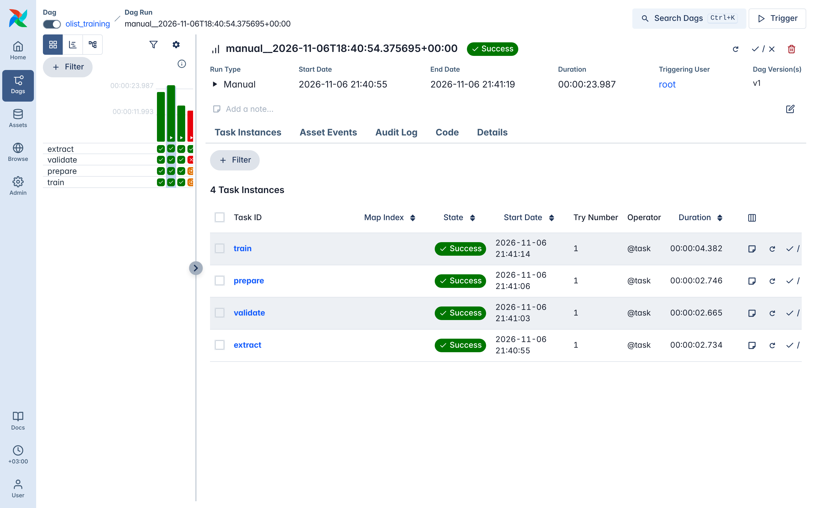
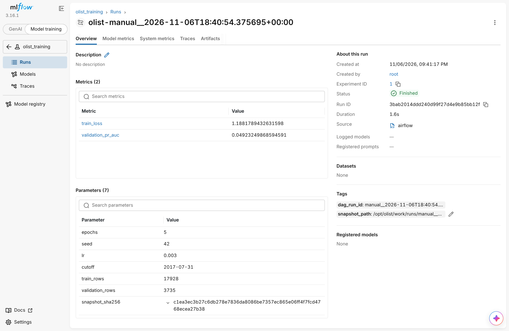

# Olist: локальный ML-пайплайн PostgreSQL → Airflow → MLflow

Пайплайн обучает готовую модель опоздания доставки Olist. Данные читаются из PostgreSQL, Airflow запускает четыре этапа, а эксперимент вместе с моделью сохраняется в MLflow.

```
extract → validate → prepare → train
```

| Этап | Что делает | Что возвращает в XCom |
|---|---|---|
| `extract` | читает `public.orders` из PostgreSQL и сохраняет UTF-8 CSV в отдельный каталог запуска | абсолютный путь к `orders.csv` |
| `validate` | только читает CSV и проверяет: файл не пустой, все 13 столбцов на месте, `order_id` уникален, числа конечные, `late` содержит только 0/1, даты корректны | тот же путь или исключение |
| `prepare` | считает SHA256 исходного снимка и делит данные по времени через `split_by_time`, как в ноутбуке | пути к `train.csv` и `validation.csv`, `snapshot_sha256`, `cutoff`, размеры выборок |
| `train` | обучает модель через `fit_model`, пишет параметры, метрики по эпохам, тег `dag_run_id` и каталог модели `model/` в MLflow | MLflow `run_id` |

Каждый запуск DAG сохраняет файлы в свой каталог `/opt/olist/work/runs/<run_id запуска Airflow>/`. Поэтому при повторных запусках строки не накапливаются: в каждом снимке ровно 21663 заказа.

## Структура

| Путь | Назначение |
|---|---|
| `compose.yaml` | PostgreSQL, MLflow и Airflow |
| `Dockerfile`, `requirements.txt` | образ Airflow с закреплёнными версиями зависимостей |
| `src/olist_pipeline.py` | этапы пайплайна |
| `dags/olist_training.py` | DAG `olist_training` |
| `src/olist_model.py`, `src/check_model.py`, `data/` | выданные файлы, не изменялись |
| `screenshots/` | скриншоты успешного DAG и MLflow run |

## Запуск

Нужны Git, Docker с Docker Compose v2 (Docker Desktop на macOS и Windows) и около 4 ГБ RAM для Docker.

```bash
git clone YOUR_REPOSITORY_URL olist-homework
cd olist-homework
cp .env.example .env
docker compose up -d --build
docker compose ps
```

Первая сборка образа занимает несколько минут. Airflow стартует только после того, как PostgreSQL и MLflow пройдут healthcheck. Все три сервиса должны быть в состоянии `healthy`.

| Интерфейс | Адрес с компьютера | Адрес внутри Docker |
|---|---|---|
| Airflow | http://127.0.0.1:8080 | — |
| MLflow | http://127.0.0.1:5050 | http://mlflow:5000 |
| PostgreSQL | только через `docker compose exec source psql` | `source:5432` |

Порты опубликованы только на `127.0.0.1`. Чтобы изменить их, задайте `AIRFLOW_PORT` и `MLFLOW_PORT` в `.env`.

Проверьте MLflow из контейнера Airflow и число заказов в базе:

```bash
docker compose exec -T airflow python -c "import urllib.request; print(urllib.request.urlopen('http://mlflow:5000/health', timeout=5).read())"
docker compose exec -T source psql -U olist -d olist -c 'SELECT count(*), count(DISTINCT order_id) FROM orders;'
```

Ожидаемый результат — `b'OK'` и `21663 | 21663`.

## Запуск DAG

1. Откройте http://127.0.0.1:8080, включите DAG `olist_training` и нажмите **Trigger**.
2. Дождитесь, пока все четыре задачи станут зелёными.
3. Нажмите на задачу `train` и откройте **Storage → XCom**: значение `return_value` и есть MLflow `run_id`.

Те же действия из терминала:

```bash
docker compose exec -T airflow airflow dags unpause olist_training
docker compose exec -T airflow airflow dags trigger olist_training
docker compose exec -T airflow airflow dags list-runs olist_training
```

При включении DAG Airflow может сразу создать один плановый запуск за последнюю неделю — это нормальная работа еженедельного расписания.

Последний `run_id` из MLflow можно получить так:

```bash
docker compose exec -T airflow python -c "import mlflow; print(mlflow.search_runs(experiment_names=['olist_training'], max_results=1, order_by=['start_time DESC'], output_format='list')[0].info.run_id)"
```

### Настройки DAG

| Настройка | Значение |
|---|---|
| Расписание | `@weekly`, `catchup=False` |
| Одновременные запуски | `max_active_runs=1` |
| Ограничение времени | `dagrun_timeout` 1 час; задачи по 10 минут, `validate` — 5 минут, `train` — 30 минут |
| Повторы | `extract` — 3 повтора с паузой 30 секунд, `validate` — `retries=0`, остальные — без повторов |
| Правило запуска | `trigger_rule='all_success'` у `validate`, `prepare`, `train` |
| Params | `epochs` (по умолчанию `OLIST_EPOCHS=5`) и `seed` (по умолчанию `OLIST_SEED=42`) |

Чтобы запустить с другими значениями, выберите **Trigger** → параметры в форме, или выполните:

```bash
docker compose exec -T airflow airflow dags trigger olist_training -c '{"epochs": 3, "seed": 7}'
```

## Что сохраняется в MLflow

Эксперимент `olist_training`, в каждом run записаны:

- параметры `epochs`, `seed`, `lr`, `cutoff`, `train_rows`, `validation_rows`, `snapshot_sha256`;
- метрики `train_loss` и `validation_pr_auc` по эпохам (`step` = номер эпохи);
- тег `dag_run_id` — точный `run_id` запуска Airflow, и тег `snapshot_path` — путь к снимку;
- артефакт `model/` — `weights.pt` и `preprocessing.json` из `save_predictor`.

По тегу `dag_run_id` находится исходный запуск Airflow, а по `snapshot_sha256` и `snapshot_path` — снимок данных `/opt/olist/work/runs/<run_id>/orders.csv`. Проверить хеш снимка:

```bash
docker compose exec -T airflow sh -c 'sha256sum /opt/olist/work/runs/*/orders.csv'
```

## Проверка модели

Подставьте `run_id` из своего окружения:

```bash
docker compose exec -T airflow python -m check_model --run-id RUN_ID
```

Пример из моего окружения:

```bash
docker compose exec -T airflow python -m check_model --run-id 3bab2014ddd240d99f27d4e9b85bb12f
```

```json
{"run_id": "3bab2014ddd240d99f27d4e9b85bb12f", "rows": 5, "probabilities": [0.7106088399887085, 0.5012526512145996, 0.2709537446498871, 0.14351080358028412, 0.22757220268249512]}
```

Этот run соответствует запуску Airflow `manual__2026-11-06T18:40:54.375695+00:00`: `epochs=5`, `seed=42`, `cutoff=2017-07-31`, `train_rows=17928`, `validation_rows=3735`, `snapshot_sha256=c1ea3ec3b27c6db278e7836da8086be7357ec865e06ff4f7fcd4768ecea27b38`. Итог последней эпохи: `train_loss=1.1882`, `validation_pr_auc=0.0492`.

## Результаты проверок

**Два ручных запуска.** Оба завершились успешно и создали разные MLflow run (`3bab2014ddd240d99f27d4e9b85bb12f` и `98bac2746e1f4cb0a4e8f44dd1ffbaf7`). В каждом снимке 21663 строки, хеши снимков совпадают, данные не удваиваются.

**Испорченный снимок.** `extract` был временно изменён так, чтобы возвращать копию снимка с повторённой строкой. Запуск остановился на `validate` с ошибкой `order_id has 1 duplicated values`, а `prepare` и `train` получили статус `upstream_failed`. После проверки код восстановлен.

Проверку можно повторить без изменения кода, вызвав `validate` на испорченной копии:

```bash
docker compose exec -T airflow sh -c 'f=$(ls -d /opt/olist/work/runs/*/ | head -1)orders.csv; { cat "$f"; tail -n 1 "$f"; } > /tmp/orders_broken.csv; python -c "import olist_pipeline; olist_pipeline.validate(\"/tmp/orders_broken.csv\")"'
```

**Clear для train.** В `train` временно добавлено исключение `RuntimeError`, запуск `manual__2026-11-06T18:42:30.868852+00:00` упал на `train`. После исправления кода в интерфейсе выбрана задача `train` → **Clear Task Instance** (Upstream и Downstream выключены, затронута одна задача) → **Confirm**. Перезапустилась только `train` (попытка 2), `extract`, `validate` и `prepare` остались на попытке 1. Запуск стал `success` и создал MLflow run `e507006140b14375bf12089d8f01106b`.

**Перезапуск и пересоздание MLflow.**

```bash
docker compose restart
docker compose up -d --force-recreate --no-deps mlflow
docker compose ps
docker compose exec -T airflow python -m check_model --run-id RUN_ID
```

После того как MLflow снова стал `healthy`, прогноз по прежнему `run_id` совпал до последнего знака, параметры и метрики сохранились: база SQLite и артефакты лежат в именованном volume `mlflow-data`. Команду `docker compose down -v` не используйте — она удаляет volumes.

**Params.** Запуск с `{"epochs": 3, "seed": 7}` создал run `b1e8d547937a4aa3b2c014d362195023` с `epochs=3` и `seed=7`.

## Скриншоты

Успешный запуск DAG с состояниями задач:



MLflow run с параметрами и метриками:



## Остановка

```bash
docker compose down
```

Контейнеры удаляются, данные PostgreSQL, история Airflow, снимки и модели MLflow остаются в volumes.

## Лицензия данных

Набор Olist распространяется по CC BY-NC-SA 4.0, условия — в `data/LICENSE.md`.
